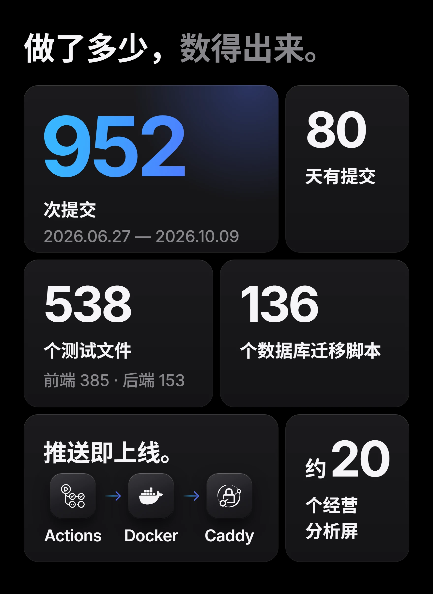

- [park-demo3](https://github.com/BearsBearxy/park-demo3) — 灵睿 LinkSight 源码：工业园区经营管理系统。
- [Income-Inequality-Data-Visualization](https://github.com/BearsBearxy/Income-Inequality-Data-Visualization) — 收入不平等数据可视化，用 R 写的。

数字数于 2026-10-11
